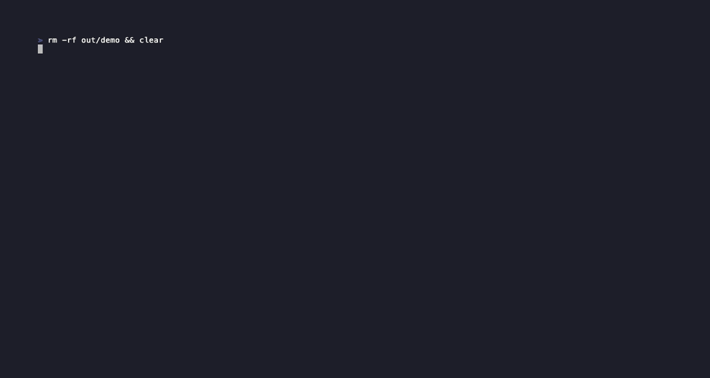
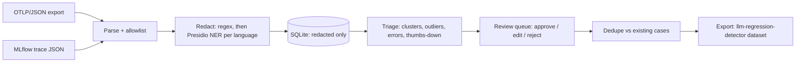

# trace-to-golden

Turns production LLM traces (OpenTelemetry GenAI, MLflow) into reviewed, PII-free golden eval cases for teams that gate releases on an eval set.

[](https://github.com/adel-saoud/trace-to-golden/actions/workflows/ci.yml)
[](pyproject.toml)
[](LICENSE)



## Why

The best eval cases come from real failures: the answer a user flagged as wrong, the request
that timed out, the question nobody planned for. They sit in your traces, mixed with thousands
of ordinary calls and full of names, emails and account numbers.

trace-to-golden picks the traces worth a human look, removes the PII before anything is
stored, and exports what a reviewer approves straight into the
[llm-regression-detector](https://github.com/adel-saoud/llm-regression-detector) dataset.

## Try it

```bash
git clone https://github.com/adel-saoud/trace-to-golden
cd trace-to-golden
uv sync
uv run ttg demo
```

`uv sync` also installs the English and French spaCy models (`en_core_web_sm`,
`fr_core_news_md`) from the spaCy release page, so the demo needs no network after setup and
no API key.

### On your own traces

```bash
uv run ttg ingest traces.jsonl                     # OTLP/JSON or Collector file exporter output
uv run ttg ingest mlflow.jsonl --source mlflow     # one Trace.to_json() per line
uv run ttg triage
uv run ttg review                                  # or: ttg approve <id> --category ... --rubric ... --rubric ...
uv run ttg export --out golden.json --existing path/to/current_golden.json   # --schema v1 for the old format
```

How to export traces from your stack, and every `TTG_*` setting:
[docs/configuration.md](docs/configuration.md).

## How it works



1. **Ingest.** OpenTelemetry GenAI spans (semconv v1.37 `gen_ai.input.messages` /
   `gen_ai.output.messages`, plus the older `gen_ai.prompt.{i}.content` layout) and exported
   MLflow 3 traces. One record per top-most GenAI span, so an agent span and its nested model
   calls give one case.
2. **Allowlist, then redact.** Only the fields in `TraceRecord` are copied out of a trace;
   everything else (customer ids, URLs, tool arguments) is dropped. Free text then goes
   through regex first (emails, phones, Luhn-checked cards, IBANs, street addresses, your own
   patterns), then Presidio NER in the language picked by a stop-word count. Presidio skips
   anything regex already replaced. The store only accepts `RedactedTrace`, so Pyright rejects
   code that would write raw text.
3. **Triage.** TF-IDF (English and French stop words removed) + HDBSCAN groups questions by
   intent; the strongest member of each cluster is queued, plus every trace flagged as an
   error, negative feedback, a cluster outlier, or a latency or token outlier (robust z-score
   on median and MAD).
4. **Review.** `ttg review` walks the queue. Approve, edit the question, reference answer,
   category and rubric (one pass or fail criterion per line), or reject with a reason.
5. **Export.** Approved cases are deduplicated against your current dataset (exact match after
   normalisation, then TF-IDF cosine) and written in the llm-regression-detector format:
   schema v2 by default (`{"schema_version": 2, "cases": [...]}`), or the v1 bare list with
   `--schema v1`.

A French trace before and after redaction:

```text
Bonjour, je suis Camille Dubois. Où en est ma commande CMD-48213977 ? Livrez au 12 rue de Rivoli, 75001 Paris.
Bonjour, je suis <PERSON>. Où en est ma commande <ORDER_ID> ? Livrez au <STREET_ADDRESS>.
```

Modules, privacy rules and failure modes: [docs/architecture.md](docs/architecture.md).

## Results

Dataset: the bundled synthetic traces, 102 traces from a shopping and after-sales assistant (a
coordinator, a product catalog agent and an orders and returns agent) in English and French,
generated by [`scripts/generate_samples.py`](scripts/generate_samples.py) with 66 planted PII
values listed in
[`pii_ground_truth.json`](src/trace_to_golden/samples/data/pii_ground_truth.json).
`uv run python scripts/reproduce.py` runs the demo pipeline with each redactor, checks the
stored SQLite bytes against that list, and writes every number below, with its sample size,
method, package versions and dataset hashes, to
[`results/manifest.json`](results/manifest.json).

| Step | Result |
|---|---|
| Redaction (regex, then Presidio) | 66 of 66 planted PII values removed (34 English, 32 French); 6 extra detections (4 PERSON, 2 LOCATION) |
| Redaction (regex only, light mode) | 55 of 66: every email, phone, card, street address and order id, none of the 11 names |
| Attribute allowlist | 0 of 95 customer ids and URLs reach the store |
| Triage | 16 intent clusters, 33 flagged traces, 47 candidates for review |
| Export (schema v2) | 44 cases written, all valid against the llm-regression-detector v2 JSON Schema; 3 dropped as duplicates |

The set is small and uses common names, so these numbers show that the pipeline works end to
end. They say nothing about recall on production text. `tests/test_redact.py` also fails the
build if any planted value reaches the store.

## Design decisions

- [ADR 0002](docs/adr/0002-allowlist-attributes-and-redact-before-storage.md): an attribute
  allowlist and redaction run before storage, and the store accepts redacted records only.
- [ADR 0003](docs/adr/0003-regex-then-presidio-redaction.md): regex first, then Presidio NER
  per language, with regex alone as a light mode that misses names.
- [ADR 0005](docs/adr/0005-tfidf-hdbscan-and-robust-z-scores-for-triage.md): TF-IDF + HDBSCAN
  groups intents without an embedding model or an API key.

All records: [docs/adr/README.md](docs/adr/README.md).

## Limits

- The GenAI semantic conventions are at Development status and moved to
  [their own repository](https://github.com/open-telemetry/semantic-conventions-genai). All
  attribute names live in `src/trace_to_golden/ingest/otel_genai.py`.
- The MLflow adapter reads `request_preview` and `response_preview`, which MLflow may truncate
  on very long requests. If all your traces are in MLflow and MLflow datasets suit you, MLflow 3
  already builds eval datasets from traces (`mlflow.genai.datasets.create_dataset`,
  `merge_records`).
- Triage builds a dense pairwise distance matrix, so memory grows with the square of the trace
  count. Above a few tens of thousands of traces per run, triage a time window or a sample.
- A v2 case needs a category, a reference answer or a rubric. Traces that failed have no
  answer, so they export only once a reviewer adds a category or a rubric. Schema v1 needs a
  category and drops reference answers and rubrics.
- No file is written when no case is left, because v2 rejects an empty dataset.
- Language detection counts stop words, which is enough for full sentences in the configured
  languages but not for one-word messages or mixed-language text.
- NER misses names it has never seen in context. The small French model tagged "Ma livraison"
  as a name, so French uses the medium one. Treat the redacted store as sensitive.

## Part of a system

- [llm-gateway](https://github.com/adel-saoud/llm-gateway) and
  [agent-mesh](https://github.com/adel-saoud/agent-mesh) emit the OpenTelemetry traces this tool reads.
- [llm-regression-detector](https://github.com/adel-saoud/llm-regression-detector) runs the
  exported cases and blocks the merge when quality drops.

## Development

```bash
uv sync
uv run pre-commit install --hook-type pre-commit --hook-type commit-msg
uv run pre-commit run --all-files   # ruff, pyright strict, gitleaks, schema copy check, no em-dashes
uv run pytest                       # coverage >= 90%
uv run python scripts/reproduce.py  # regenerate results/manifest.json, then re-record the GIF
uv run python scripts/sync_schemas.py   # refresh the pinned schema copy after a pin bump
uv run python scripts/generate_samples.py   # rebuild the synthetic traces
vhs docs/demo.tape                  # re-record the demo GIF
```

Releases: `uv run cz bump` updates the version and the tag; `CHANGELOG.md` is written by hand. The package is
not on PyPI; install it from GitHub with
`uv tool install git+https://github.com/adel-saoud/trace-to-golden`. Decision records:
[docs/adr/README.md](docs/adr/README.md). Library behaviour checked against docs:
[docs/verified.md](docs/verified.md).

## License

[MIT](LICENSE)
