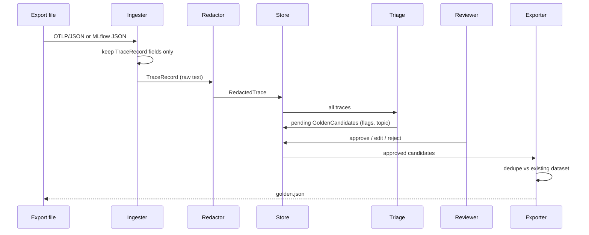

# Architecture

## Modules

| Module | Role |
|---|---|
| `ingest/otlp_json.py` | Parse OTLP/JSON (hex ids, int64 as strings) into spans |
| `ingest/otel_genai.py` | GenAI semantic-convention names and span-to-record mapping; the only place those names appear |
| `ingest/mlflow_json.py` | Exported MLflow 3 traces to records, without importing MLflow |
| `models.py` | `TraceRecord` (the allowlist), `RedactedTrace`, `TriageResult`, `GoldenCandidate` |
| `language.py` | Stop-word language detection and the stop-word list used by clustering |
| `redact/` | `Redactor` protocol, regex and Presidio redactors chained in that order, `redact_record` |
| `store.py` | SQLite store; accepts `RedactedTrace` only |
| `triage/` | TF-IDF + HDBSCAN clustering, rule flags, candidate selection |
| `review.py` | Approve (with edits) and reject |
| `dedupe.py` | Exact and near-duplicate detection |
| `export/regression_detector.py` | The only module that knows the llm-regression-detector dataset format: schema v2 (default) and v1 |
| `pipeline.py` | `ingest`, `triage`, `export` steps used by the CLI |
| `cli.py` | `ttg` commands and the offline demo |

## Data flow

## Privacy rules

1. Allowlist first: an ingester copies only `TraceRecord` fields. A new attribute is dropped
   until someone adds it to the model on purpose.
2. Redact before storage: `Store.add_traces` takes `RedactedTrace`, built only by
   `redact_record`.
3. Defense in depth: regex runs first (checksummed cards and IBANs, emails, phones, street
   addresses, team patterns from `TTG_EXTRA_REDACTION_PATTERNS`), then Presidio NER in the
   detected language. Presidio drops any finding that overlaps a placeholder, so `<ORDER_ID>`
   never becomes `<<PERSON>>`.
4. The test `test_no_planted_pii_reaches_the_store` scans the raw SQLite bytes for every
   planted value.

## Failure modes

| Situation | What happens |
|---|---|
| Malformed line in an export file (bad JSON, or a shape the OTLP models reject) | `ttg ingest` stops with the parse error. Records are stored only after the whole batch is read and redacted, so nothing from that run reaches the store. |
| Span or trace with no user text | Skipped: no record, no candidate. |
| Messages attribute that is not valid JSON | Read as no messages, so the span gives no record. |
| spaCy model for a configured language not installed | Building the Presidio redactor fails, so ingest stops before storing. `TTG_REDACTOR=regex` runs without models. |
| Fewer traces than `TTG_MIN_CLUSTER_SIZE` | Every trace is noise (cluster -1); only flagged traces are queued. |
| Ingesting the same file twice | Records already stored are skipped, and a candidate already in the queue keeps its review state. |
| `ttg approve` or `ttg reject` on an unknown id | Exit code 1 with a message; the store is unchanged. |
| No approved case left after dedupe | No file is written, since schema v2 rejects an empty dataset. |
| A name NER has never seen in context | It stays in the stored text. Treat the store as sensitive. |

## Adding a source or a target

- New trace source: add an ingester that returns `TraceRecord`s and a `TraceSource` value;
  redaction, storage and triage stay unchanged.
- New dataset schema: add a `DatasetSchema` value, a converter and its requirement check in
  `export/regression_detector.py`. `tests/fixtures/golden-dataset.v2.schema.json` is a
  byte-for-byte copy of llm-regression-detector's canonical schema at the tag pinned in
  `scripts/sync_schemas.py`. Bump the pin, run the script, and add a CHANGELOG entry; the
  `--check` hook fails pre-commit and CI when the copy drifts, and the export tests validate
  against it.
- New language or country: add it to `TTG_SPACY_MODELS` and install that spaCy model. Its
  keys drive language detection and the clustering stop words. Check which Presidio
  recognizers exist for the language (French has no credit card recognizer, which is one
  reason regex runs first) and add regex patterns for local formats such as phone numbers
  and addresses.

## Language detection

`StopWordLanguageDetector` counts each configured language's spaCy stop words in the text and
picks the highest count; a tie goes to the first configured language. It needs no extra
dependency and no model download, which suits short support messages in a known set of
languages. A trained detector would be the next step for mixed-language text or many
languages.
